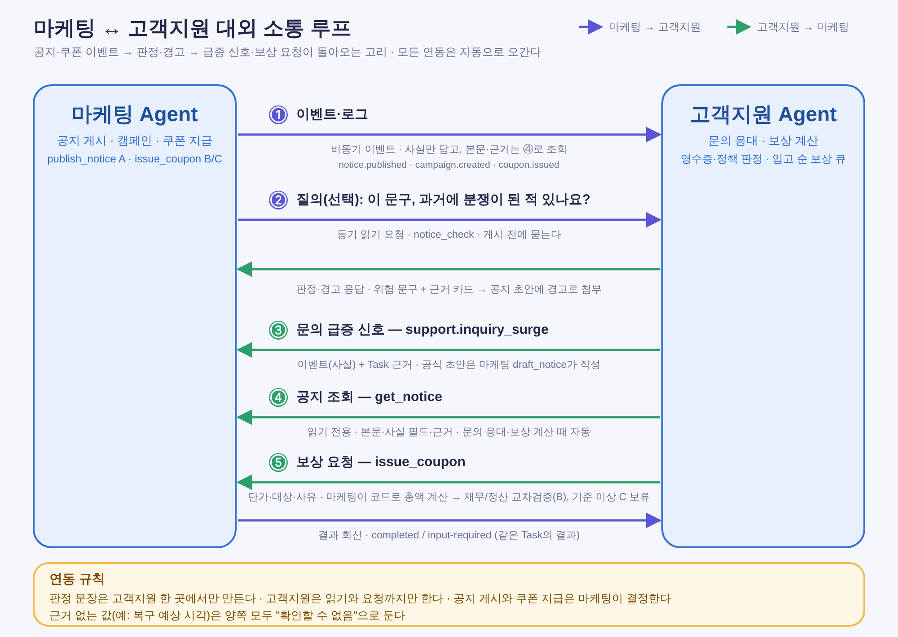
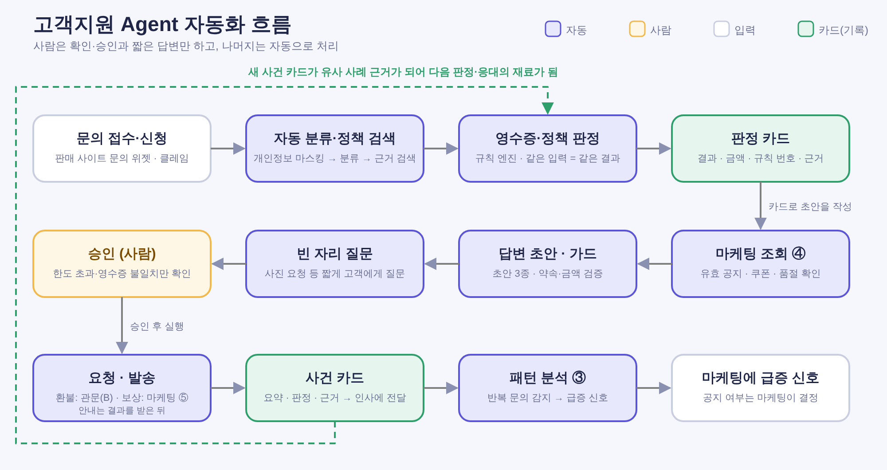
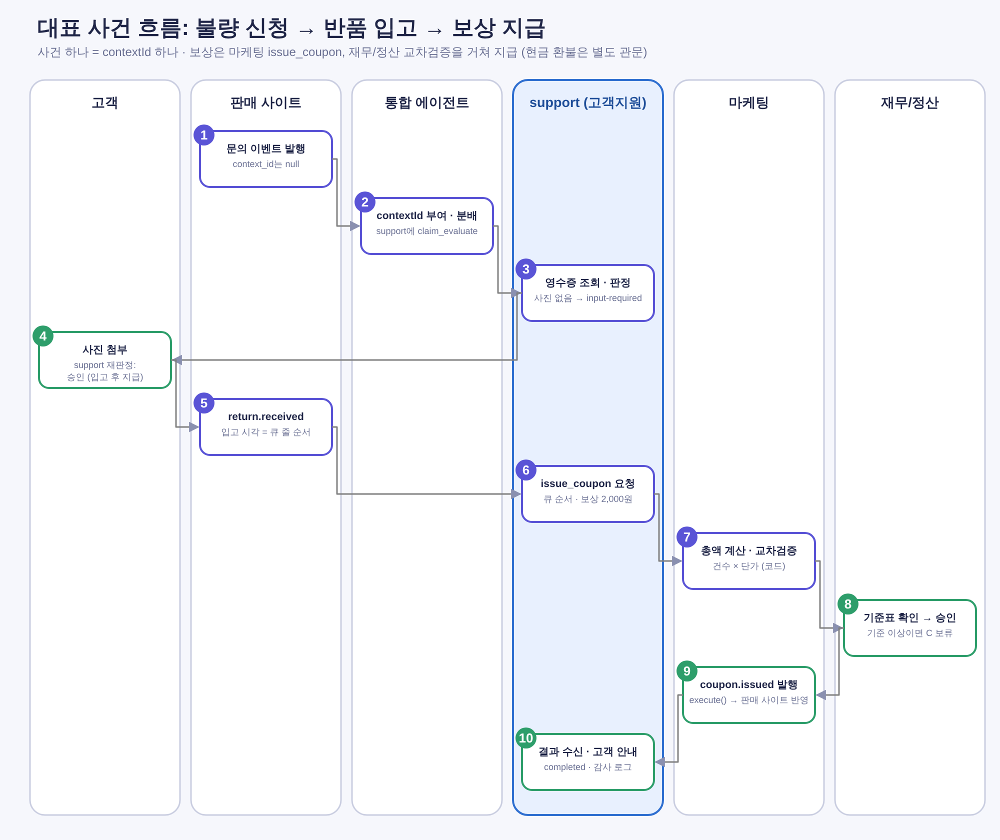
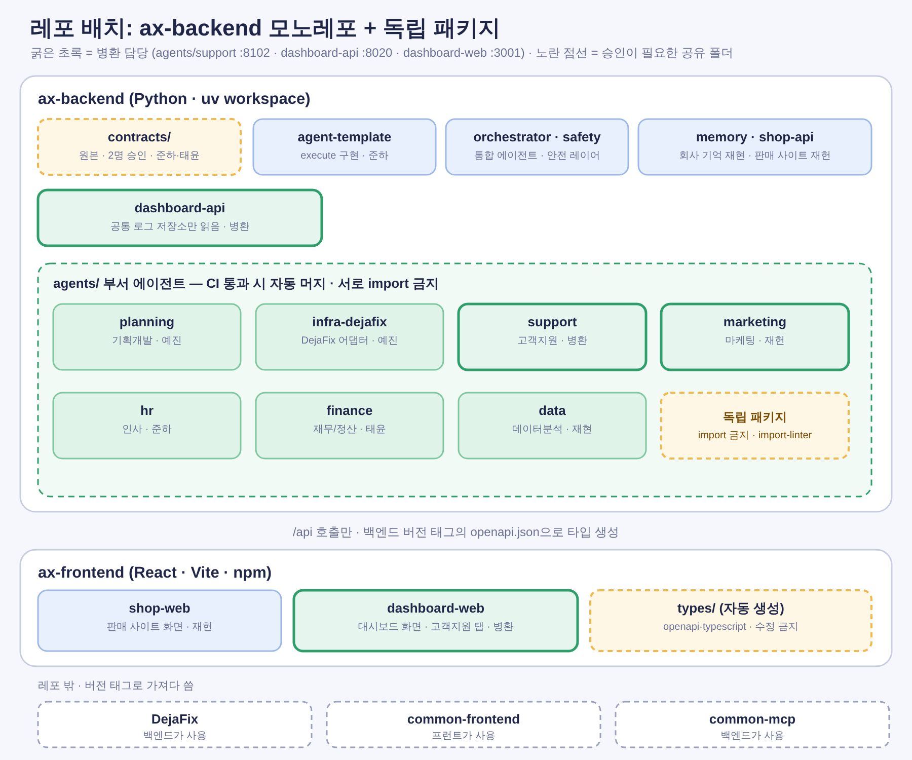

# 마케팅 ↔ 고객지원 대외 소통 루프

「기획개발 ↔ 인사운영 개선 루프」와 같은 구조로 마케팅 에이전트(`marketing`, 재헌)와 고객지원 에이전트(`support`, 병환)의 연동을 정리한 문서다.
조직도에서 두 부서를 잇는 점선 "대외 소통"을 구체화한 것이고, 공지·상품·쿠폰(마케팅)과 문의 응대·보상 계산(고객지원)이 서로의 기록과 요청을 주고받는 고리다.

이 문서는 재헌의 「마케팅 부서(AI) + 판매 사이트 기획안」(2026-10-21)을 반영해 고쳤다. 무엇을 어떻게 맞췄는지는 [기획안 대조](marketing-plan-alignment.md)에 있다.
상위 문서: [고객지원 에이전트 구성안](support-agent-plan.md) · 팀 공통 규약(2026-10-21).
표기: **[제안]** 합의 전, **[규약]** 팀 공통 규약 그대로, **[재헌 안]** 재헌 기획안의 제안, **[현재 코드]** 이 저장소 프로토타입에서 이미 되는 것.

---

## 1. 한눈에 보기



| 번호 | 방향 | 방식 | 무엇을 주고받나 | 출처 |
|---|---|---|---|---|
| ① 이벤트·로그 | 마케팅 → 고객지원 | 비동기 이벤트 | `notice.published`, `campaign.created`, `coupon.issued`. 사실만 담고 본문·근거는 ④에서 조회 | [재헌 안] 5-4 |
| ② 질의 (선택) | 마케팅 → 고객지원 | 동기 읽기 요청 | 게시 전 공지 초안의 정책 충돌·과거 분쟁 점검(`notice_check`) ← 판정·경고와 근거 카드 | [제안] 재헌 확인 필요 |
| ③ 문의 급증 신호 | 고객지원 → 통합(→ 마케팅) | 비동기 이벤트 | `support.inquiry_surge` + 근거(Task). 공식 초안은 마케팅 `draft_notice`가 작성 | [재헌 안] 6-1(c) |
| ④ 공지 조회 | 고객지원 → 마케팅 | 읽기 요청 | `get_notice`: 공지 본문·사실 필드·근거. 문의 응대와 보상 계산 때 자동 | [재헌 안] 6-1(a), skill 추가 요청 |
| ⑤ 보상 요청 | 고객지원 → 마케팅 | A2A 요청 | `issue_coupon`: 보상 단가·대상·사유. 마케팅이 코드로 총액 계산, 재무/정산 교차검증(B), 기준 이상은 C 보류. 결과를 회신 | [재헌 안] 6-1(b) |

### 연동 규칙 (이 루프의 헌법)

1. **판정 문장은 고객지원 한 곳에서만 만든다.** 공지가 정책·약속과 충돌하는지, 과거 분쟁이 있었는지, 보상 대상이 맞는지의 판정은 고객지원이 하고, 마케팅은 결과를 첨부만 한다.
2. **고객지원은 읽기와 요청까지만 한다.** 공지·쿠폰·상품을 직접 바꾸지 않는다. 쿠폰·적립금 지급은 마케팅의 `issue_coupon`, 판매 사이트 쓰기는 각자의 실행 관문 뒤에서만 한다.
3. **공지 게시·쿠폰 지급은 마케팅이 결정한다.** 고객지원의 경고·신호는 판단 재료이고, 마케팅이 무시할 수 있다 (무시한 사실은 기록).
4. **같은 사실 원천을 쓰고, 근거 없는 값은 "확인할 수 없음"으로 둔다.** 장애 중 복구 예상 시각처럼 근거가 없는 값은 공지와 상담 답변 모두 만들지 않는다 [재헌 안].
5. **모든 연동은 자동으로 오간다.** 사람이 중간에서 전달하지 않는다. 대신 규약의 안전장치(contextId, 실행 관문, 근거 첨부, 멱등성 키)가 전부 적용된다.

> 기획개발 ↔ 인사운영 루프와 역할 대응:
>
> | 기획개발 ↔ 인사운영 | 마케팅 ↔ 고객지원 |
> |---|---|
> | 기획개발: 티켓·배포를 결정, 이벤트·로그를 보냄 | 마케팅: 공지·쿠폰을 결정, 이벤트를 보냄 |
> | 인사운영: 기록을 쌓고 판정·경고, 개선 티켓 초안 제안 | 고객지원: 문의·판정 기록을 쌓고 판정·경고, 급증 신호와 근거 제공 |
> | 기각된 안과 근거 카드 | 과거 분쟁·문의 사례와 근거 카드 |

---

## 2. 연동별 상세

### ① 이벤트·로그 (마케팅 → 고객지원)

마케팅이 공지·캠페인·쿠폰을 처리할 때마다 공통 봉투의 이벤트로 알린다. **이벤트에는 사실만** 있고 문장(본문·원인)은 없다 [재헌 안 5-1].

```json
{
  "event_id": "evt_0101",
  "type": "notice.published",
  "version": 1,
  "occurred_at": "2026-10-21T05:45:00Z",
  "tenant_id": "shop-demo",
  "context_id": "ctx_inc_0001",
  "source": "marketing",
  "idempotency_key": "notice.published:ntc_0001",
  "data": { "notice_id": "ntc_0001", "channel_code": "banner", "context_id": "ctx_inc_0001" },
  "untrusted": {}
}
```

| 받는 이벤트 | data | 고객지원에서의 쓰임 |
|---|---|---|
| `notice.published` | notice_id, channel_code, context_id | 응대 근거로 쓸 공지가 생겼음을 알림. 본문은 ④로 조회 |
| `campaign.created` | campaign_id, target_codes[], starts_at, ends_at | 진행 중 프로모션 기간·대상 확인 (보상과 이벤트 쿠폰 중복 방지) |
| `coupon.issued` | coupon_id, campaign_id, count, total_value | ⑤ 요청의 결과 확인, 이미 지급된 쿠폰과의 중복 확인 |

- 판매 사이트의 `product.sold_out`, `product.stock_low`, `product.price_changed`는 재헌 안에서 [후속]이다. 그전까지 재입고·가격 문의는 판매 사이트 상품 조회(API)로 응대한다.
- 같은 `event_id`는 한 번만 처리한다 (멱등성).
- [현재 코드] 정책 문서(`app/kb`)는 정적 파일이다. 공지는 **기간이 있는 임시 근거**라서 별도 저장소(공지 색인)와 검색 대상 추가가 필요하다.

### ② 질의: 이 문구, 과거에 분쟁이 된 적 있나요? (마케팅 → 고객지원, 선택)

재헌 안의 마케팅 안전 규칙에는 게시 전 **형식 검증**(길이·금지 패턴·링크 허용 목록)이 있다. 이것과 별개로, 정책·약속 충돌을 보는 **읽기 전용 점검**을 고객지원이 해 줄 수 있다. 재헌이 받아들이면 연동하고, 아니어도 다른 연동에는 영향이 없다 [제안].

**요청** `notice_check`: `{ context_id, draft: { title, public_text, promises[] }, untrusted }`

**응답**:

```json
{
  "verdict": "ok | warn | block",
  "findings": [
    {
      "code": "ABSOLUTE_WORDING",
      "level": "block",
      "message": "'무조건 전액 환불'은 전자책·주문제작 굿즈의 단순변심 환불 불가 규정과 충돌합니다.",
      "evidence": { "policy_refs": ["KB-REF-01#3"], "cases": ["inq-1042", "claim-88"] }
    }
  ],
  "similar_cases": [ { "id": "inq-1042", "summary": "전액 환불 문구를 보고 전자책 환불을 요구", "outcome": "자동 거절 후 불만" } ],
  "computed": { "max_exposure": 12000, "basis": "예상 대상 주문 × 약속 금액 (코드 계산)" }
}
```

- 판정은 규칙(코드)이 하고 LLM은 설명 문장을 다듬는 데만 쓴다. 노출 금액 같은 숫자는 코드가 계산한다 (규약).
- 마케팅은 응답을 공지 초안에 경고로 첨부한다. `block`을 무시하고 게시해도 되지만 감사 로그와 대시보드에 기록한다 [제안].
- 응답은 **같은 Task의 결과**로 돌려준다. 새 요청으로 되돌리면 `marketing → support → marketing` 경로가 되어 루프 거부에 걸릴 수 있다 [규약 해석, 준하 확인].
- [현재 코드] 재사용: 답변 가드의 단정적 표현·정책에 없는 금액 약속·조건부 정책 검출, 정책 수치(`rules/policy.py`). 새로 필요: 가드를 공지 초안에도 쓰도록 일반화, 과거 사례 색인, 노출 금액 계산.

### ③ 문의 급증 신호 (고객지원 → 통합 → 마케팅)

같은 주제의 문의가 급증하면 고객지원이 **신호**를 보낸다. 공지를 낼지, 문안을 어떻게 쓸지는 마케팅의 `draft_notice`가 정한다 [재헌 안 6-1(c)].

**감지 규칙(코드)** [제안, 임계값은 병환이 정하고 데이터분석과 조율]

| 패턴 | 조건 예 | 신호 |
|---|---|---|
| 카테고리 급증 | 같은 분류 문의가 최근 24시간에 평소 대비 N배 | `topic_code` = 분류 |
| 반복 질문 | 같은 정책 조항(`KB-DEL-01#2` 등)을 인용한 문의가 N건 이상 | `topic_code` = 정책 조항 |
| 약속 오해 | 같은 공지에서 파생된 자동 거절이 N건 이상 | 공지 문구 수정 검토 신호 |
| 상품 문제 | 같은 상품의 불량 신청이 N건 이상 | 상품 점검 신호 (마케팅·상품MD, 기획개발 티켓 검토) |

```json
{
  "event_id": "evt_0201",
  "type": "support.inquiry_surge",
  "version": 1,
  "occurred_at": "2026-10-21T05:50:00Z",
  "tenant_id": "shop-demo",
  "context_id": null,
  "source": "support",
  "idempotency_key": "support.inquiry_surge:delivery:2026-10-21T05",
  "data": { "topic_code": "delivery", "count": 37, "window": "PT24H" },
  "untrusted": { "sample_inquiries": ["주문한 지 6일째인데 배송이 안 와요"] }
}
```

- 이벤트에는 사실(분류·건수·구간)만 있고, **근거(사례 ID, 집계 쿼리)는 A2A Task의 `근거` 필드**로 보낸다 [재헌 안 5-2].
- 문의 원문은 `untrusted`에만 담고, 마케팅은 지시로 해석하지 않는다.
- 선택 첨부: FAQ 후보 문안. 공식 초안이 아니라 **참고 자료**이고, 채택은 마케팅이 정한다. 새로운 보상 약속은 포함하지 않는다 (금액 기준은 재무/정산 소관).
- [현재 코드] 분류별 집계(`by_category`)와 가드 적발 통계가 있다. 시간대별 기준선 비교와 이벤트 발행은 새로 만든다.

### ④ 공지 조회 (고객지원 → 마케팅, 읽기)

문의를 응대하거나 보상액을 계산하기 전에 자동으로 마케팅에서 현재 상태를 읽는다. 재헌 안은 이를 A2A `get_notice`(제안)로 적었으나 마케팅의 skill 5개에는 아직 없다 → **추가를 요청한다**.

| 조회 | 쓰임 |
|---|---|
| `get_notice(notice_id)` → 본문, 사실 필드(component·상태·사건 ID), 근거 | 고객이 "공지에서 봤다"고 할 때 근거 확인, 답변 초안에 인용 |
| 진행 중 캠페인·쿠폰 (`campaign.created`, `coupon.issued` 기록) | 보상과 이벤트 쿠폰의 **중복 지급 방지**, 쿠폰 조건 문의 응대 |
| 판매 사이트 상품 조회 `shop_get_product` (MCP) | 영수증 가격과 현재 가격이 다를 때 설명, 재입고 문의 |

- 읽기 전용이라 등급 대상이 아니다. 근거(조회 시각, 대상 ID)를 결과에 첨부한다 [규약].
- 공통 봉투 `{ok, collected_at, data, truncated}`와 목 모드를 따른다 [규약, common-mcp].
- 마케팅 DB를 직접 읽지 않는다. 마케팅이 제공하는 skill·API로만 읽는다.
- **공지 본문에 약속이 있으면 구조화된 `promises[]`가 필요하다**(요청 사항). 문장에서 금액을 뽑아 쓰지 않는다. 없으면 해당 약속은 응대·보상에 쓰지 않는다.
- 답변 가드 확장: 공지에 없는 복구 시각을 약속하는 문장을 막는다.

### ⑤ 보상 요청 (고객지원 → 마케팅 → 재무/정산)

판정 결과 보상이 필요하면 고객지원은 직접 지급하지 않고 마케팅에 요청한다. 쿠폰 지급은 마케팅의 `issue_coupon`(B, 기준 이상 C)이고, 판매 사이트 `POST /api/coupons`는 마케팅 관문만 호출한다 [재헌 안 3-5, 6-1(b)].

| 단계 | 누가 | 무엇 | 등급 | 데이터 |
|---|---|---|---|---|
| 1 | 고객지원 | 판정 엔진으로 **보상 단가·대상** 계산, 마케팅에 `issue_coupon` 요청 | A (요청) | 사유 코드, 대상(`buyer_id`), 단가, context_id, 멱등성 키 `coupon:<context_id>:<buyer_id>` |
| 2 | 마케팅 (코드) | 총액 = 건수 × 단가 계산, 재무 기준표로 등급 판정 | 코드 | 계산식, 기준표 버전 |
| 3 | 마케팅 → 재무/정산 | 교차검증 요청 | B | 계산 결과 |
| 4a | 재무/정산 → 마케팅 | 확인 → 마케팅 `execute()` 지급 → `coupon.issued` | B | coupon_id, count, total_value |
| 4b | 기준 이상·거절·타임아웃 | 미지급, 보류 + 근거 리포트 | C | 계산식·기준·요청자 |
| 5 | 마케팅 → 고객지원 | 결과 회신 | — | Task completed / input-required |
| 6 | 고객지원 | 결과를 근거로 고객 안내 작성(지급 확정 전에는 약속하지 않음), 사건 기록 | — | 답변 초안·가드 |

- **입고 순 큐와의 관계**: 큐는 반품 입고 순서대로 요청을 보낸다. 마케팅이 비동기로 처리하면 완료 순서가 뒤바뀔 수 있으므로, 순서가 중요한 경우 한 건씩 결과를 받고 다음 건을 보내거나 요청에 `sequence`를 담는다 [제안, 결정 대기].
- **현금 환불**은 쿠폰이 아니라 판매 사이트의 결제 환불이다. 고객지원이 자기 실행 관문(B)을 거쳐 판매 사이트에 요청한다 (환불 이벤트·API는 재헌 안의 [후속], 승격 요청).
- [현재 코드] 큐 조건(검수·한도·재고·점검)과 순서, 금액 계산은 이미 있다. 지급 부분이 "요청 보내기"로 바뀐다.

---

## 3. 고객지원 자동화 흐름 (자동 / 사람 / 입력 / 카드)



인사운영 Agent 자동화 흐름과 같은 읽는 법이다. 사람은 **확인·승인과 짧은 답변**만 하고 나머지는 자동이다.

| 순서 | 단계 | 구분 | 내용 | 산출물 |
|---|---|---|---|---|
| 1 | 문의 접수·신청 | 입력 | 판매 사이트 문의 위젯, 클레임 신청 | 문의 |
| 2 | 자동 분류·정책 검색 | 자동 | 개인정보 마스킹, 분류, 근거 검색 (**[현재 코드]**) | 분석 카드 |
| 3 | 영수증·정책 판정 | 자동 | 규칙 엔진 (**[현재 코드]**) | **판정 카드**: 결과·금액·규칙 번호·근거 |
| 4 | 마케팅 조회 (④) | 자동 | 유효 공지·쿠폰 확인 | 공지 근거 |
| 5 | 답변 초안·가드 | 자동 | 초안 3종, 약속·금액 검증 (**[현재 코드]**) | 초안 |
| 6 | 빈 자리 질문 | 자동 | 사진 요청 등 고객에게 짧게 질문 (**[현재 코드]** `needs_info`) | 질문 |
| 7 | 승인 | **사람** | 한도 초과·영수증 불일치·검수 불일치 등만 확인·승인 (C 등급 처리 방식은 결정 대기) | 승인 기록 |
| 8 | 요청·발송 | 자동 | 현금 환불은 관문(B), 보상은 마케팅 `issue_coupon` 요청(⑤), 안내 발송 | 실행 결과 |
| 9 | 사건 카드 기록 | 카드 | 사건 요약·판정·근거를 카드로 저장, 인사 에이전트에 전달 | **사건 카드** |
| 10 | 패턴 분석 (③) | 자동 | 사건 카드가 쌓여 급증 신호의 재료가 됨 | 신호 |

사건 카드가 다음 응대의 재료(유사 사례 근거)와 ③의 재료가 되어 고리가 닫힌다.

---

## 4. 규약 적용

### 4-1. skill과 등급 (고객지원이 이 루프에서 갖는 것)

| skill | 방향 | 하는 일 | 등급 | 요청 가능 에이전트(ACL, 제안) |
|---|---|---|---|---|
| `notice_check` | 수신 (②) | 공지 초안 정책 충돌 점검 (선택) | 읽기 | marketing, 통합 |
| `compensation_request` | 발신 (⑤) | 마케팅 `issue_coupon`을 호출해 보상 요청 | A (요청, 고객지원의 상태 변경 없음) | — (마케팅의 skill을 호출) |
| `get_notice` 호출 | 발신 (④) | 공지 본문·사실 필드 조회 | 읽기 | — (마케팅의 skill을 호출, 추가 요청) |
| `refund_request` | 발신 | 판매 사이트에 현금 환불 반영 요청 | B (재무 교차검증) | — |
| 이벤트 수신 처리 | 수신 (①) | 공지·캠페인·쿠폰 이벤트 색인 | A | marketing |
| `support.inquiry_surge` 발행 | 발신 (③) | 급증 신호 | A | — |

- 마케팅의 `publish_notice`는 A, `issue_coupon`은 B(기준 이상 C)이고 마케팅이 재무/정산에 신고한다 [재헌 안 9-2].
- 고객지원은 ③에서 신호만 보내고 ⑤에서 요청만 보내므로, 고객지원 자신의 **쿠폰·공지 상태 변경은 없다.**

### 4-2. Task 확장 필드 사용

| 필드 | 이 루프에서의 쓰임 |
|---|---|
| contextId | 공지 하나·사건 하나가 하나의 사건. ①~⑤ 모두 같은 contextId |
| 마감 시각 | ②는 동기 질의이므로 짧게. ⑤는 교차검증 시간 포함. 초과 시 고객지원은 "확인 중"으로 안내하고 지급을 약속하지 않음 |
| 경로 | 되돌아오는 경로는 루프 거부 대상일 수 있음. ②·⑤의 응답은 새 Task가 아니라 같은 Task의 결과로 돌려준다 |
| 근거 | ③의 사례 ID·집계, ②의 findings, ⑤의 계산식이 이 필드에 들어간다 (이벤트가 아니라 Task) |
| untrusted | 공지 본문, 고객 문의 원문, 상품 설명 등 외부 문구 |

### 4-3. 해서는 안 되는 것 (README "하지 않는 것"에 추가)

- 고객지원은 공지·프로모션·상품·쿠폰을 직접 바꾸거나 지급하지 않는다.
- 마케팅은 고객지원의 내부 판정 근거(반복 신청 점검 점수 등)를 받지 않는다. ②·⑤의 응답에도 넣지 않는다.
- 공지 문구에서 금액을 정규식으로 추출해 지급 계산에 쓰지 않는다. `promises[]` 구조화 값만 쓴다.
- 이벤트에 개인정보를 넣지 않는다. `buyer_id`(가명)만 쓴다.
- 후기 삭제·별점 조건의 보상 공지를 승인하지 않는다 (현재 정책은 후기 삭제 조건만 금지하므로 **별점·내용 조건 보상 금지 조항을 정책 문서에 추가**) [제안].

---

## 5. 대표 시나리오



위 그림은 [구성안](support-agent-plan.md)의 대표 사건(불량 신청 → 반품 입고 → 보상 지급)이다. 시나리오 A~D는 이 루프(①~⑤)가 들어가는 경우다.

### 시나리오 A: 배송 지연 급증 → 공지 → 문의 감소 (③ → ① → ④)

1. 고객지원이 배송 문의가 평소의 6배임을 감지 (코드 규칙).
2. ③ `support.inquiry_surge`를 발행, 근거(사례 ID, 집계 쿼리)는 Task로 전달.
3. 마케팅이 `draft_notice`로 초안을 만들고 형식 검증 후 `publish_notice`(배너, A).
4. ① `notice.published`가 고객지원에 도착.
5. 이후 배송 문의는 ④ `get_notice`로 공지를 읽어 답변 초안에 인용한다.
6. 대시보드에서 공지 전후 문의량 변화를 본다.

### 시나리오 B: 위험한 프로모션 문구를 게시 전에 차단 (② 경고, 선택 연동)

1. 마케팅 초안: "지금 사면 무조건 전액 환불".
2. ② `notice_check` → `block`: 단정적 표현, 전자책·주문제작 굿즈 환불 불가 규정과 충돌(`KB-REF-01#3`), 과거 유사 사례 첨부.
3. 마케팅이 문구를 고쳐 다시 질의 → `ok` → 게시.
4. 무시하고 게시하면 감사 로그와 대시보드에 "block 무시 게시"로 기록.

### 시나리오 C: 쿠폰 이벤트와 보상 중복 방지 (④ → ⑤)

1. 마케팅이 "이번 주 구매자 전원 적립금 1,000원" 이벤트 진행 중 (`campaign.created`).
2. 고객이 배송 지연 보상(적립금 1,000원)을 신청.
3. 보상 요청 전에 ④로 진행 중 캠페인·쿠폰을 조회해 같은 목적의 지급이 이미 있는지 확인.
4. 중복이면 `issue_coupon` 요청에 경고를 담고, 재무/정산 교차검증(B)에서 판단.

### 시나리오 D: 주문 서버 장애 → 공지 → 문의 응대 → 보상 쿠폰 [재헌 안 7-1]

contextId = `ctx_inc_0001`(예시). 고객지원이 맡는 구간만 적는다.

| # | 주체 | 행동 | 등급 |
|---|---|---|---|
| 1 | 판매 사이트 | `shop.degraded` 발행 | — |
| 2 | 통합 에이전트 | 사건 판단, contextId 부여, 인프라·고객지원·마케팅에 Task 분배 | — |
| 3 | 마케팅 | `draft_notice` → `publish_notice`(배너) → `notice.published` | A |
| 4 | **고객지원** | ① 수신 → ④ `get_notice`로 사실 필드(component·상태·사건 ID) 확인 → 문의 응대. 복구 예상 시각은 근거 없으므로 "확인할 수 없음" | A |
| 5 | **고객지원** | 보상 필요 판정 → ⑤ `issue_coupon` 요청 (재헌 7-1의 7단계) | A (요청) |
| 6 | 마케팅 → 재무/정산 | 코드 계산 → 교차검증 → 기준 미만이면 지급 `coupon.issued`, 기준 이상이면 C 보류 | B / C |
| 7 | **고객지원** | 결과 회신을 받아 고객 안내 (C 보류면 지급을 약속하지 않음) | — |
| 8 | 판매 사이트 | `shop.recovered` → 마케팅 복구 공지 | A |
| 9 | 통합·대시보드 | 사건 종료, 같은 contextId로 전 단계 표시 | — |

---

## 6. 저장소와 폴더 배치 (모노레포 + 독립 패키지) [제안]

팀 설계(통합 시연이 핵심이므로 모노레포로 시작하되, 부서 폴더를 독립 패키지처럼 만든다)에 맞춘 배치다. 재헌 안도 레포 구성을 결정 대기로 두었다(확인 필요 12). 합의 후 확정한다.



```
ax-backend/                         Python · uv workspace
├─ contracts/                       원본 · 2명 승인 (schemas · data-access · openapi)
│   └─ schemas/  event-envelope.json, support_inquiry_surge.json, notice_check.json
├─ agent-template/                  execute 구현 · 준하
├─ orchestrator/ · safety/ · memory/
├─ shop-api/                        판매 사이트 서버 · 재헌
├─ dashboard-api/                   공통 로그 저장소만 읽음 · 병환
└─ agents/                          CI 통과 시 자동 머지
    ├─ support/                     고객지원 · 병환  ← 독립 패키지
    │   ├─ pyproject.toml · README.md(5항목) · Dockerfile · .env.example
    │   ├─ src/support/  rules/ claims/ queue/ copilot/ kb/ notices/
    │   └─ tests/
    └─ marketing/                   마케팅 · 재헌
ax-frontend/                        React · Vite · npm
├─ dashboard-web/                   대시보드 화면 · 병환 (고객지원 탭, 연동 현황)
└─ types/                           openapi에서 자동 생성 · 수정 금지
```

| 규칙 | 고객지원에서 지킬 것 |
|---|---|
| 독립 패키지: import 금지, DB는 API·뷰로만 | `agents/support`는 `agents/marketing`을 import하지 않는다. 마케팅 데이터는 ④의 skill·API로만 읽는다 |
| 데이터 접근은 계약으로 | 이벤트 봉투·`support.inquiry_surge`·`notice_check` 형식은 `contracts/schemas`에 정의하고 2명 승인 |
| 대시보드는 공통 로그 저장소만 읽음 | 연동 현황(①~⑤ 건수, 경고 무시 게시)은 공통 로그로 받는다 |
| CODEOWNERS는 공유 폴더만 | `agents/support`는 병환이 소유, CI 통과 시 자동 머지 |
| CI에서 LLM은 mock | 현재 프로토타입의 mock 제공자와 테스트가 그대로 맞는다 |
| 프로젝트 후 `git filter-repo`로 독립 레포 분리 | 다른 폴더 의존을 만들지 않는다 |

[현재 코드] `backend/app/{rules,claims.py,queue.py,copilot,kb}`가 `agents/support/src/support/`로 이동할 대상이다. `shop.py`, `api_shop.py`, 쇼핑몰 화면은 판매 사이트(재헌)의 **참조 구현**으로 남긴다 ([구성안 15장](support-agent-plan.md)).

---

## 7. 개발 순서 (이 루프 기준)

| 단계 | 할 일 | 의존 |
|---|---|---|
| 1 | 이벤트 봉투·`support.inquiry_surge`·`notice_check` 스키마 초안을 재헌의 이벤트 스키마와 맞춰 작성 | 재헌 |
| 2 | 답변 가드를 공지 초안에도 쓰도록 일반화 (`notice_check`의 규칙 부분), 공지에 없는 복구 시각 약속 차단 규칙 추가 | 없음 (바로 시작) |
| 3 | 사례 카드 저장소: 문의·클레임에서 유사 사례를 찾을 색인 | 없음 |
| 4 | 큐의 지급 부분을 `issue_coupon` 요청으로 바꾸고, 목 마케팅 클라이언트·목 이벤트(①)로 단독 테스트 (멱등성, C 보류, untrusted) | common-mcp 규격 |
| 5 | 문의 급증 감지 규칙과 ③ 이벤트 발행 (규칙은 코드) | 단계 3 |
| 6 | 마케팅 에이전트와 실제 A2A 연동, 통합 시나리오 A~D 리허설 | 준하(템플릿), 재헌 |
| 7 | 대시보드에 연동 현황 화면 (공지 전후 문의량, 경고 무시 게시, 보상 요청 결과) | dashboard-api |

단계 2·3은 다른 사람의 규격을 기다리지 않고 지금 시작할 수 있다.

---

## 8. 확인 필요

[기획안 대조 5장](marketing-plan-alignment.md)의 결정 대기와 이어진다.

| # | 질문 | 제안 |
|---|---|---|
| 1 | **적립금과 쿠폰을 같은 것으로 볼지** | 같은 `issue_coupon`으로 처리하는 안. 사용·소멸 규칙이 다르면 분리 |
| 2 | **현금 환불 실행의 주체와 등급** | 고객지원이 B(재무 교차검증)로 요청 |
| 3 | **보상 요청의 처리 순서 보장** (비동기 완료 순서) | 한 건씩 결과를 받고 다음 건을 보내거나 `sequence` 전달 |
| 4 | **`get_notice` skill 추가와 `promises[]` 필드** | 재헌에게 요청. 없으면 해당 약속은 응대에 쓰지 않음 |
| 5 | 판매 사이트 이벤트 승격: `payment.refunded`, `shipment.delayed` → [필수], 신규 `order.delivered`, `return.received` | 재헌에게 요청. 우리 판정이 배송 예정·도착일, 반품 입고 시각에 의존 |
| 6 | ② `notice_check`를 마케팅 게시 흐름에 넣을지, `block` 무시 게시를 허용할지 | 허용하되 감사 로그·대시보드에 기록 |
| 7 | ②·⑤ 응답이 `marketing → support → marketing` 경로가 되어 루프 거부에 걸리는가 | 같은 Task의 결과로 반환. 준하 확인 |
| 8 | 교차검증 거절·타임아웃의 Task 상태 (`input-required` / `failed`) | 고객지원 Task 상태 매핑과 함께 결정 |
| 9 | ③ 급증 임계값(N배, N건) | 병환이 초안 제시, 데이터분석과 조율 |
| 10 | 별점·내용 조건 보상 금지 정책 추가 | 정책 문서에 조항 추가 (고객지원 소관) |
| 11 | 모노레포 + 독립 패키지 배치 확정 | 결정 기록에 한 줄 추가 후 6장을 확정으로 변경 |
| 12 | C 보류 해제 주체와 사람 승인 단계의 관계 | [구성안 14장 확인 필요 1](support-agent-plan.md)과 같은 안건 |
