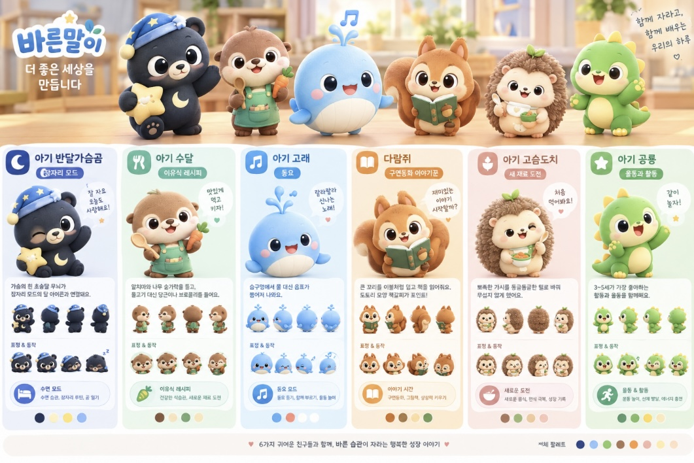

# 캐릭터 활용 계획 (바른말이 캐릭터 6종)

{width=6in height=4.0in}

## 0. 한눈에 보기

| 항목 | 내용 |
|---|---|
| 자료 | 사용자가 제공한 캐릭터 시트 1장. 브랜드 문구 "바른말이 더 좋은 세상을 만듭니다", 동물 캐릭터 6종 |
| 용도 | 육아 앱 개발에 사용할 캐릭터 (사용자 설명) |
| 시트의 강점 | 6종이 같은 화풍·색감으로 통일되어 있고, **캐릭터마다 맡은 기능이 정해져 있어** 기획서의 화면 구성과 바로 연결된다 |
| 개발 전 확인 | ① 브랜드명 '바른말이' 사용 여부 ② 이미지 속 글자 오류 ③ 기존 캐릭터와의 유사성 ④ AI 생성 이미지의 라이선스와 권리 ⑤ 앱에 쓸 자산(분리 이미지·애니메이션) 준비 |

## 1. 캐릭터 6종과 기획서 연결

시트에 적힌 내용과 기획서(p.3~4)의 화면을 대응시킨 표다.

| 캐릭터 | 시트 속 역할 | 연결되는 기획서 기능 | 시트의 디자인 포인트 |
|---|---|---|---|
| 아기 반달가슴곰 | 잠자리 모드 (수면 습관, 잠자리 루틴, 꿈 일기) | 잠자리 모드(어두운 화면, 15·30·45분 타이머, 볼륨 감소) | 가슴의 흰 초승달 무늬가 잠자리 모드의 달 아이콘과 이어짐, 잠옷 모자, 별 |
| 아기 수달 | 이유식 레시피 (건강한 식습관, 새로운 재료 도전) | 이유식 탭(초기·중기·후기·완료기, 재료 검색, 보관법) | 앞치마, 나무 숟가락, 당근 |
| 아기 고래 | 동요 (듣기, 함께 부르기, 율동 놀이) | 동요 탭(재생목록, 한 곡 반복, 율동 영상, 가사 표시) | 숨구멍에서 물 대신 음표가 나옴 |
| 다람쥐 | 구연동화 이야기꾼 (구연동화, 그림책, 상상력 키우기) | 동화 탭(그림책 모드, 나레이션+하이라이트, 오디오 모드) | 큰 꼬리를 이불처럼 덮고 책을 읽음, 도토리 모양 책갈피 |
| 아기 고슴도치 | 새 재료 도전 (새로운 음식, 편식 극복, 성장 기록) | 새 재료 기록(처음 먹여봤어요, 반응 기록, 보관함 달력) | 가시를 동글동글한 털로 바꿔 무섭지 않게 함, 새싹 |
| 아기 공룡 | 율동과 활동 (운동 놀이, 신체 발달, 에너지 충전) | 동요 탭의 율동 영상, 2차 기능(성장 기록) | 3~5세가 좋아하는 활동과 율동 |

**미배정**: 홈(오늘의 추천)과 보관함(즐겨찾기, 다운로드)은 담당 캐릭터가 없다. 홈은 6종이 함께 나오는 화면으로 쓰거나 다람쥐를 안내자로 정하는 방법이 있다.

## 2. 활용 위치 제안

| 위치 | 활용 방식 |
|---|---|
| 온보딩 | 6종 소개와 아이 월령 입력 안내. 캐릭터가 말풍선으로 설명 |
| 하단 탭·헤더 | 탭별 담당 캐릭터를 아이콘이나 헤더 일러스트로 사용 |
| 잠자리 모드 | 곰과 달 아이콘을 어두운 화면 중앙에 두고, 타이머 종료 시 곰이 잠드는 연출 |
| 새 재료 기록 | 고슴도치가 "처음 먹여봤어요!"로 기록 버튼을 안내. 반응(괜찮음/확인 필요) 선택 화면의 표정 사용 |
| 맞춤 동화 생성(RAG) | 다람쥐 이야기꾼을 생성 진행 화면의 안내자로 사용 ("이야기를 만드는 중이에요") |
| 낭독 | 다람쥐를 내레이터 캐릭터로 정하고 그에 어울리는 타입캐스트 보이스를 선정(청취 테스트 필요) |
| 빈 화면·알림·오류 | 상황에 맞는 표정 컷을 사용 |
| 스토어 | 앱 아이콘과 스크린샷 후보. 6종 중 대표 1종 또는 단체 컷 |

## 3. 개발 전 준비물 (자산 체크리스트)

시트에는 캐릭터별로 **정면·측면·후면 4방향**, **표정·동작 4종**, **색상 팔레트**가 있다. 이는 좋은 출발점이지만 앱에 바로 넣기에는 부족하다.

| 자산 | 상태 | 비고 |
|---|---|---|
| 고해상도 원본 | 확인 필요 | 현재 파일은 시트 한 장. 캐릭터별 원본이 필요 |
| 투명 배경 분리 이미지(PNG 또는 벡터) | 필요 | 앱 화면과 애니메이션에 사용 |
| 표정 세트 확대 | 필요 | 기쁨, 놀람, 졸림, 먹는 중, 박수, 슬픔(약하게) 등 앱 상황용 |
| 아이콘 크기별 버전 | 필요 | 탭 아이콘, 앱 아이콘, 알림용 |
| 어두운 배경용 버전 | 필요 | 잠자리 모드 화면에서 가독성 확보 |
| 애니메이션 프레임 또는 파츠 분리 | 필요 | 기획서 p.7의 "2D 파츠 리깅·루프" 방식에 필요한 분리 레이어 |
| 캐릭터 바이블 | 필요 | 이름, 성격, 말투, 해도 되는 표현·안 되는 표현, 비율·색상 규칙 |
| 생성 워크플로우 기록 | 필요 | 기획서 p.6의 캐릭터 시트 생성(krea2)과 이미지 편집(Qwen-Image, ComfyUI)에서 일관성을 유지하는 설정을 고정 |

## 4. 주의할 점 (시트에서 확인한 것)

1. **이미지 속 한글 오류**: 곰 카드의 '잠자리 모드' 라벨에 글자가 겹쳐 있고, 수달 설명문의 일부 글자가 깨져 있으며, 하단 팔레트 문구가 '써체 팔레트'로 보인다. AI로 생성한 이미지에 들어간 글자는 오류가 잦으므로, **이미지에서 글자를 빼고 앱에서 별도로 입력**하는 편이 안전하다.
2. **브랜드명 '바른말이'**: 같은 이름의 마스코트가 멘토링 자료의 문해력 앱(주제1)에도 나온다. 기획서 p.11의 '앱 이름'은 아직 미정이므로, 육아 앱 이름으로 쓸 것인지 먼저 정해야 한다. 상표 사용 가능 여부는 확인하지 않았다(특허청 검색 등으로 확인 필요). '바른말'이라는 어감이 육아·동요·이유식 앱과 맞는지도 부모 반응으로 점검할 수 있다.
3. **기존 캐릭터와의 유사성**: 기획서 p.8은 "기존 유명 캐릭터·브랜드와 닮지 않음"을 검수 기준으로 둔다. 고래, 공룡처럼 시장에 비슷한 소재가 많은 캐릭터는 출시 전에 비교 검수가 필요하다. (실제로 닮았는지는 제가 판단하지 않았다.)
4. **AI 생성 이미지의 권리**: 기획서 p.8의 "AI 이미지 상업 라이선스 확인"에 해당한다. 사용한 도구의 약관과 함께, AI가 만든 캐릭터가 법적으로 어느 범위까지 보호되는지는 국가마다 다르므로 법률 전문가에게 확인해야 한다. 사람이 수정·선택한 과정과 원본 프롬프트·설정을 기록해 두는 것이 좋다.
5. **고유 이름 부재**: 지금은 '아기 수달', '다람쥐'처럼 종 이름이다. IP로 키우려면 캐릭터별 고유 이름과 성격이 필요하다.
6. **월령별 가독성**: 0~12개월에는 단순한 형태와 대비가 큰 색이 좋다. 현재 시트는 부모가 보는 앱 화면 중심이므로, 영상·그림책 안에서의 표현은 별도로 정한다.
7. **카드 문구는 부모 대상**: 시트의 설명문은 부모에게 하는 말이다. 아이에게 보이는 화면과 부모용 화면의 문구를 구분한다.

## 5. 시장조사에 추가할 문항 (초안)

| 구분 | 문항 |
|---|---|
| 인터뷰 | 이 캐릭터들을 보고 어떤 앱이라고 느끼시나요? 아이가 좋아할 것 같은 캐릭터와 그 이유는? 기존에 아이가 좋아하는 캐릭터와 비슷하게 느껴지는 것이 있나요? |
| 설문 | 캐릭터 호감도(캐릭터별 1~5점), 가장 마음에 드는 캐릭터 1개, 캐릭터와 기능의 연결이 이해되는지, '바른말이' 이름에서 연상되는 앱 종류, 기존 캐릭터와 닮았다고 느끼는 것(자유 서술) |

6종 이미지를 응답자에게 보여줄 때는 이미지 속 글자 오류가 없는 버전을 쓴다.

## 6. 결정이 필요한 사항

1. 앱 이름과 '바른말이' 사용 여부 (문해력 앱 마스코트와의 중복 정리)
2. 캐릭터 고유 이름과 성격, 말투
3. MVP에서 먼저 쓸 캐릭터 (예: 곰=잠자리 모드, 다람쥐=동화, 수달=이유식, 고슴도치=새 재료 기록, 고래=동요)
4. 공룡의 담당 기능 위치 (기획서에는 율동 영상이 동요 탭에 있고 별도 '활동' 기능은 없음)
5. 홈과 보관함의 담당 캐릭터
6. AI 생성 캐릭터의 권리 확인 방식과 담당자
7. 캐릭터 자산의 제작 방식 (현 시트 기반 재생성 / 디자이너 정리)
